<div align="center">

# 📊 broad-index-dashboard

**A股宽基指数 / 板块基金 / 黄金 的量化分析工具集**

每个脚本产出一份自带交互的单文件 HTML（Plotly 渲染），双击打开就能用，
不需要装浏览器插件，也不用起本地服务器——每个交易日凌晨还会自动重新生成一份最新的。

[](https://github.com/Owen434/broad-index-dashboard/actions/workflows/daily_update.yml)
[](requirements.txt)
[](https://akshare.akfamily.xyz/)
[](https://plotly.com/python/)
[](#license)


</div>

<!-- DAILY_SUMMARY:BEGIN -->
## 📅 今日风险速览 · 2026-10-22

- **宽基指数**：16 个，最热 道琼斯 🟠 高风险（85 分）；高风险及以上 1 个
- **ETF 资金流**：净申赎分位最高 沪深300（净申购 +236.13 亿，分位 100%）🔵 冰点；最低 中证A500（净赎回 -0.10 亿，分位 16%）🟠 高风险
- **板块基金**：板块 平均 33 分 🟦 偏冷（🔵 冰点 9、🟦 偏冷 38、🟢 正常 10、🟡 偏热 5）
- **COMEX 黄金**：四周期斜率均值分位 24% 🟦 偏冷

> 风险口径：`🔵 冰点<20 · 🟦 偏冷<40 · 🟢 正常<60 · 🟡 偏热<80 · 🟠 高风险<90 · 🔴 极端风险≥90`，分位数(0~1)乘 100 后套同一张表。

### ① 宽基指数风险总览

| 指数 | 分类 | 最新点位 | 涨跌幅 | 过热评分 | 风险等级 |
|---|---|---:|---:|---:|---|
| 道琼斯 | 美股宽基 | 52,856.09 | +0.69% | 85 | 🟠 高风险 |
| 北证50 | A股宽基 | 966.74 | -0.93% | 58 | 🟢 正常 |
| 纳斯达克 | 美股宽基 | 26,702.86 | +1.05% | 56 | 🟢 正常 |
| 标普500 | 美股宽基 | 7,757.17 | +0.58% | 56 | 🟢 正常 |
| 中证500 | A股宽基 | 6,655.25 | -2.71% | 29 | 🟦 偏冷 |
| 科创50 | A股宽基 | 1,305.87 | -2.78% | 29 | 🟦 偏冷 |
| 上证指数 | A股宽基 | 3,658.03 | -1.48% | 23 | 🟦 偏冷 |
| 上证50 | A股宽基 | 2,724.81 | -0.81% | 22 | 🟦 偏冷 |
| 深证成指 | A股宽基 | 11,357.32 | -2.97% | 22 | 🟦 偏冷 |
| 上证收益 | A股宽基 | 8,972.53 | -1.22% | 22 | 🟦 偏冷 |
| 沪深300 | A股宽基 | 4,036.30 | -1.84% | 22 | 🟦 偏冷 |
| 创业板指 | A股宽基 | 2,576.90 | -4.37% | 15 | 🔵 冰点 |
| 恒生指数 | 港股宽基 | 22,934.68 | -3.03% | 13 | 🔵 冰点 |
| 恒生科技指数 | 港股宽基 | 3,793.93 | -5.03% | 7 | 🔵 冰点 |
| 韩国综合指数 | 外盘宽基 | 0.00 | -100.00% | 4 | 🔵 冰点 |
| 日经225 | 外盘宽基 | 0.00 | -100.00% | 3 | 🔵 冰点 |

### ② 宽基 T+1 情景模拟（不同涨跌幅对应的风险）

| 指数 \ 明日涨跌 | +3% | +2% | +1% | +0% | -1% | -2% | -3% |
|---|---|---|---|---|---|---|---|
| 道琼斯 | 🟠 高风险 88 | 🟠 高风险 87 | 🟠 高风险 85 | 🟠 高风险 83 | 🟢 正常 44 | 🟢 正常 44 | 🟢 正常 44 |
| 北证50 | 🟢 正常 58 | 🟢 正常 58 | 🟢 正常 58 | 🟢 正常 42 | 🟢 正常 42 | 🟢 正常 42 | 🟦 偏冷 30 |
| 纳斯达克 | 🟢 正常 56 | 🟢 正常 56 | 🟢 正常 56 | 🟢 正常 56 | 🟢 正常 56 | 🟦 偏冷 25 | 🟦 偏冷 23 |
| 标普500 | 🟡 偏热 74 | 🟡 偏热 71 | 🟢 正常 56 | 🟢 正常 56 | 🟢 正常 44 | 🟦 偏冷 29 | 🟦 偏冷 27 |
| 中证500 | 🟢 正常 50 | 🟢 正常 50 | 🟦 偏冷 35 | 🟦 偏冷 29 | 🟦 偏冷 29 | 🟦 偏冷 29 | 🔵 冰点 17 |
| 科创50 | 🟢 正常 50 | 🟢 正常 50 | 🟦 偏冷 29 | 🟦 偏冷 29 | 🟦 偏冷 29 | 🟦 偏冷 29 | 🟦 偏冷 23 |
| 上证指数 | 🟢 正常 58 | 🟢 正常 58 | 🟦 偏冷 36 | 🟦 偏冷 29 | 🔵 冰点 16 | 🔵 冰点 15 | 🔵 冰点 14 |
| 上证50 | 🟢 正常 58 | 🟢 正常 58 | 🟢 正常 42 | 🟦 偏冷 29 | 🔵 冰点 16 | 🔵 冰点 14 | 🔵 冰点 14 |
| 深证成指 | 🟢 正常 50 | 🟦 偏冷 35 | 🟦 偏冷 29 | 🟦 偏冷 28 | 🟦 偏冷 28 | 🔵 冰点 16 | 🔵 冰点 15 |
| 上证收益 | 🟢 正常 58 | 🟢 正常 58 | 🟦 偏冷 36 | 🟦 偏冷 23 | 🔵 冰点 16 | 🔵 冰点 14 | 🔵 冰点 14 |
| 沪深300 | 🟢 正常 58 | 🟦 偏冷 36 | 🟦 偏冷 35 | 🟦 偏冷 29 | 🟦 偏冷 22 | 🔵 冰点 15 | 🔵 冰点 8 |
| 创业板指 | 🟦 偏冷 35 | 🟦 偏冷 29 | 🟦 偏冷 29 | 🟦 偏冷 22 | 🔵 冰点 16 | 🔵 冰点 15 | 🔵 冰点 15 |
| 恒生指数 | 🟢 正常 42 | 🟦 偏冷 24 | 🟦 偏冷 21 | 🔵 冰点 19 | 🔵 冰点 19 | 🔵 冰点 7 | 🔵 冰点 6 |
| 恒生科技指数 | 🟦 偏冷 36 | 🟦 偏冷 23 | 🟦 偏冷 21 | 🔵 冰点 14 | 🔵 冰点 8 | 🔵 冰点 7 | 🔵 冰点 6 |
| 韩国综合指数 | 🔵 冰点 3 | 🔵 冰点 3 | 🔵 冰点 3 | 🔵 冰点 3 | 🔵 冰点 3 | 🔵 冰点 3 | 🔵 冰点 3 |
| 日经225 | 🔵 冰点 3 | 🔵 冰点 3 | 🔵 冰点 3 | 🔵 冰点 3 | 🔵 冰点 3 | 🔵 冰点 3 | 🔵 冰点 3 |

### ③ ETF 分板块资金流信号（仅合并板块，截至 2026-10-22）

> 分位为**带方向**的滚动分位：越接近 100% = 放量净申购（资金进场，偏机会），越接近 0% = 放量净赎回（资金撤退，偏风险）。

| 板块 | 方向 | 当日净申赎(亿元) | 近5日(亿元) | 净申赎分位 | 资金信号 |
|---|---|---:|---:|---:|---|
| 沪深300 | 净申购 | +236.13 | +528.41 | 100% | 🔵 冰点 |
| 上证50 | 净申购 | +45.21 | +154.24 | 100% | 🔵 冰点 |
| 中概互联 | 净申购 | +7.27 | +7.29 | 100% | 🔵 冰点 |
| 创业板 | 净申购 | +62.49 | +178.13 | 96% | 🔵 冰点 |
| 中证500 | 净申购 | +25.77 | +60.59 | 92% | 🔵 冰点 |
| 上证180 | 净申购 | +0.15 | +0.39 | 92% | 🔵 冰点 |
| 深证100 | 净申购 | +0.79 | +1.37 | 92% | 🔵 冰点 |
| 畜牧养殖 | 净申购 | +0.83 | +1.26 | 91% | 🔵 冰点 |
| 中证1000 | 净申购 | +31.37 | +42.02 | 87% | 🔵 冰点 |
| 科创50 | 净申购 | +5.97 | +14.47 | 83% | 🔵 冰点 |
| 食品饮料 | 净申购 | +0.31 | +0.58 | 71% | 🟦 偏冷 |
| 中证800 | 净申购 | +0.05 | +0.31 | 66% | 🟦 偏冷 |
| 医药医疗 | 净申购 | +0.18 | -1.84 | 66% | 🟦 偏冷 |
| 金融科技 | 净赎回 | -0.11 | -0.08 | 46% | 🟢 正常 |
| 芯片半导体 | 净赎回 | -0.57 | -1.12 | 45% | 🟢 正常 |
| 军工 | 净赎回 | -0.16 | +5.19 | 40% | 🟢 正常 |
| MSCI中国A50 | 净赎回 | -0.07 | +0.10 | 38% | 🟡 偏热 |
| 钢铁 | 净赎回 | -0.10 | -0.31 | 34% | 🟡 偏热 |
| 金融地产 | 净赎回 | -0.21 | -0.55 | 33% | 🟡 偏热 |
| 汽车 | 净赎回 | -0.03 | +0.10 | 29% | 🟡 偏热 |
| 光伏 | 净赎回 | -0.52 | -1.14 | 22% | 🟡 偏热 |
| 有色金属 | 净赎回 | -2.08 | -5.67 | 17% | 🟠 高风险 |
| 中证A500 | 净赎回 | -0.10 | -0.17 | 16% | 🟠 高风险 |

### ④ 板块基金风险汇总（截至 2026-10-22）

| 类型 / 排行 | 🔵 冰点 | 🟦 偏冷 | 🟢 正常 | 🟡 偏热 | 🟠 高风险 | 🔴 极端风险 |
|---|:---:|:---:|:---:|:---:|:---:|:---:|
| **板块** | 9 只 | 38 只 | 10 只 | 5 只 | 0 只 | 0 只 |
| **自选** | 5 只 | 14 只 | 7 只 | 0 只 | 0 只 | 0 只 |
| **最热 Top6（名次 →）** | 1. 道琼斯ETF鹏华 78 | 2. 标普消费ETF景顺 77 | 3. 标普生物科技ETF嘉实 64 | 4. 标普油气ETF富国 64 | 5. 纳指生物科技ETF汇添富 63 | 6. 机器人ETF 58 |
| **最冷 Top6（名次 →）** | 1. 东方人工智能主题混合C 8 | 2. 电池ETF 9 | 3. 恒生互联网ETF 9 | 4. 新能源ETF 9 | 5. 新能源车ETF 9 | 6. 碳中和龙头ETF 14 |

> **板块** 共 62 只，平均 33 分 🟦 偏冷；**自选** 共 26 只，平均 28 分 🟦 偏冷。第一行是六档的只数分布；后两行按名次从左到右排，格子落在哪一列只表示名次，与该列的档位无关。

### ⑤ COMEX 黄金 · 多周期均线斜率风险

最新价：4,046.7 美元 · 2026-10-22

| 周期 | 均线斜率 | 方向 | 斜率分位 | 风险等级 |
|---|---:|---|---:|---|
| 5 日 | -29.160 | 下行 | 17% | 🔵 冰点 |
| 20 日 | -13.165 | 下行 | 20% | 🔵 冰点 |
| 30 日 | -10.387 | 下行 | 27% | 🟦 偏冷 |
| 60 日 | -1.927 | 下行 | 33% | 🟦 偏冷 |
| 综合 | -- | 四周期均值 | 24% | 🟦 偏冷 |
<!-- DAILY_SUMMARY:END -->

## 目录

- 🎯 [项目特点](#项目特点)
- 📁 [目录结构](#目录结构)
- 📋 [看板一览](#看板一览)
- 📌 [关于示例数据](#关于示例数据)
- ▶️ [本地运行](#本地运行)
- ⚠️ [已知限制](#已知限制)

## 项目特点

**这套工具不是选股工具，核心目的是帮你判断"现在是不是该逃顶/减仓"**——不是告诉你买什么，
而是在市场明显过热、动能开始衰竭、或者"护盘资金"迹象消失时，提前把警示信号摆在你面前。

<table>
<tr><td width="220">🚨 <b>核心目标：逃顶预警，而不是选股</b></td><td>系统综合八大指标（MACD/RSI/KDJ/BOLL等）的历史分位，将市场状态划分为：🔵冰点、🟦偏冷、🟢正常、🟡偏热、🟠高风险、🔴极端风险。只要有多个指标同时冲向历史极值区间，评分矩阵就会用"🟠 高风险"甚至是"🔴 极端风险"这类醒目色块标出来——重点<b>不是提示买入，而是提醒你当前状态已经明显过热，该考虑减仓、落袋为安了</b>；反之，当处于"🔵 冰点"时，<b>则可考虑逢低加仓</b>。</td></tr>
<tr><td>📉 <b>斜率捕捉动能衰竭与极值，往往比价格更早</b></td><td>分位数极值预警：当 5日均线斜率超过过去95%的分位数时，表示短期增长过快、情绪过热，<b>提示需要减仓</b>；反之，当 斜率低于5%分位数时，表明短期超跌，可<b>考虑逢低加仓</b>。</td></tr>
<tr><td>🕵️ <b>ETF资金流，观察"国家队"进出场的痕迹</b></td><td>45只宽基ETF的每日净申购/净赎回数据，是判断"护盘资金"（也就是俗称的国家队）什么时候进场吸筹、什么时候悄悄减持撤退的重要线索——大跌行情里宽基ETF突然放量净申购，是值得重点关注的信号。</td></tr>
<tr><td>📐 <b>股指期货持仓，同一件事的另一个角度</b></td><td>中金所公开的会员成交持仓排名里，中信期货（市场公认的"国家队"下单席位）在上证50/沪深300/中证500/中证1000四个品种上的净持仓变化，经常和 ETF 资金流互相印证——期货端加空单同时 ETF 端却在净申购，这种背离本身就是值得留意的信号。</td></tr>
<tr><td>🎯 <b>只看宽基，不追热点个股</b></td><td>分析对象限定在沪深300、上证50、纳斯达克这类宽基指数和板块类 ETF/基金，一次性看清市场整体状态，不需要盯着几千只个股。</td></tr>
<tr><td>📐 <b>指标算法统一口径</b></td><td>MACD / RSI / BIAS / KDJ / CCI / SAR / BOLL / BW% 八大指标 + ZigZag 波浪辨识 + 过热评分，所有脚本共用同一套内核（<code>zigzag_signal_analyzer.py</code>），换脚本看数据口径不会变。</td></tr>
<tr><td>📉 <b>回撤与过热信号回测</b></td><td>统一纳入项目维护的16个宽基指数和完整基金清单，按“宽基指数 / 基金 → 类型 → 标的”筛选，统计区间收益、最大回撤、当前回撤、水下天数，以及进入不同风险等级后的5/20/60日收益和最大浮亏；基金净值先处理拆分、份额折算和分红除权。</td></tr>
<tr><td>🖱️ <b>交互式而不是静态图</b></td><td>K线形态、指标矩阵、评分看板都能缩放、切换时间范围、导出截图，不是一张扁平的 PNG。</td></tr>
<tr><td>📅 <b>收益与资金流日历，一眼看连涨连跌</b></td><td>宽基指数和板块/持有基金各有一份交互式收益日历；ETF另有一份净申赎金额日历。日历把数据铺成12宫格挂历，按分类/年份切换标的，下方配套统计表；收益日历还提供“月度排名看板”视图，同类型标的按最新月份收益倒排、逐月对比。原来是逐个标的、逐年导出高清 PNG（一次跑下来几十上百 MB），现在无论多少标的都只是一个几十~上百 KB 的 HTML，仓库体积不会因为每天自动提交而失控。</td></tr>
<tr><td>📦 <b>单文件 HTML，离线可开</b></td><td>Plotly.js 按需内嵌或走本地目录引用，生成的 HTML 拷走就能用，不依赖联网。</td></tr>
<tr><td>🔄 <b>每日自动更新</b></td><td>GitHub Actions 定时跑一遍，最新数据自动发布到本仓库的 GitHub Pages，不用自己维护服务器。</td></tr>
</table>

> ⚠️ 以上信号（暴热色块、斜率背离、ETF资金流异动）都是基于历史数据的技术观察，不是预测，
> 更不构成投资建议——市场是否真的见顶、护盘资金是否真的存在，都需要结合更多信息自行判断。

## 目录结构

```
stocks/   宽基指数看板（K线形态 + 八大指标矩阵 + ZigZag波段看板 + 评分矩阵 + 收益日历，五合一）
          含 price_movement_patterns.py（取数 + K线形态识别内核，也被 index_return_calendar.py 复用取数逻辑）
funds/    板块基金指标矩阵 / ZigZag信号 / 评分矩阵 / 风险排名百分位 / 收益日历
          含 fetch_fund_nav.py（净值历史抓取，其余脚本运行前先跑这个）
          含 zigzag_signal_analyzer.py（指标 + 评分 + 绘图内核，被 stocks/ 与 holdings_calendar.py 复用）
          含 fund_correlation_report.py（按"类型"分组的聚类 / 相关性网络图，叠加 16 个宽基指数）
          含 fund_anomaly_analysis.py（日收益率异常分析：8 种判定方法 + 下一交易日异常区间；复用上一个脚本的指数抓取）
drawdown/ 回撤与过热信号回测看板
          自动加载 stocks/ 中维护的 16 个宽基指数和 funds/funds_universe_example.csv 中的全部基金
          HTML 按“板块 → 类型 → 标的”筛选，并处理基金净值拆分、份额折算和分红除权
etf/      45只宽基ETF的申赎资金流看板 + 净申赎金额日历
          etf_net_flow_calendar.py 复用 etf_broadbase_dashboard.py 生成的 etf_flow.parquet，不重复抓取
gold/     COMEX黄金多周期均线与斜率分析
futures/  中金所股指期货会员净持仓（中信期货 / 前20会员，四个宽基品种）
          含 cffex_net_position.py（抓取+计算+出图三合一，output_cffex/ 下存缓存和历史文件）
docs/     HTML 输出（GitHub Actions 每个交易日自动重新生成，仅供预览，不建议手动改）
```

## 看板一览
| 分类 | 看板 | 预览 | 在线链接 |
|---|---|---|---|
| **① 宽基指数**（含 ETF 资金流） | 八大指标矩阵 |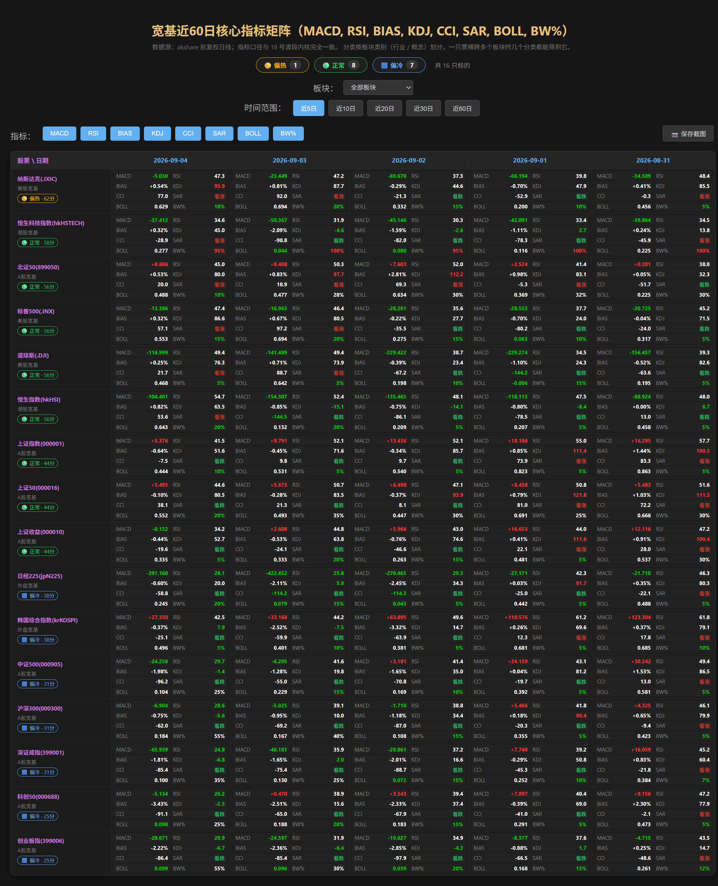  | https://owen434.github.io/broad-index-dashboard/stock_8indicators_matrix.html |
| | ZigZag 波段看板 | 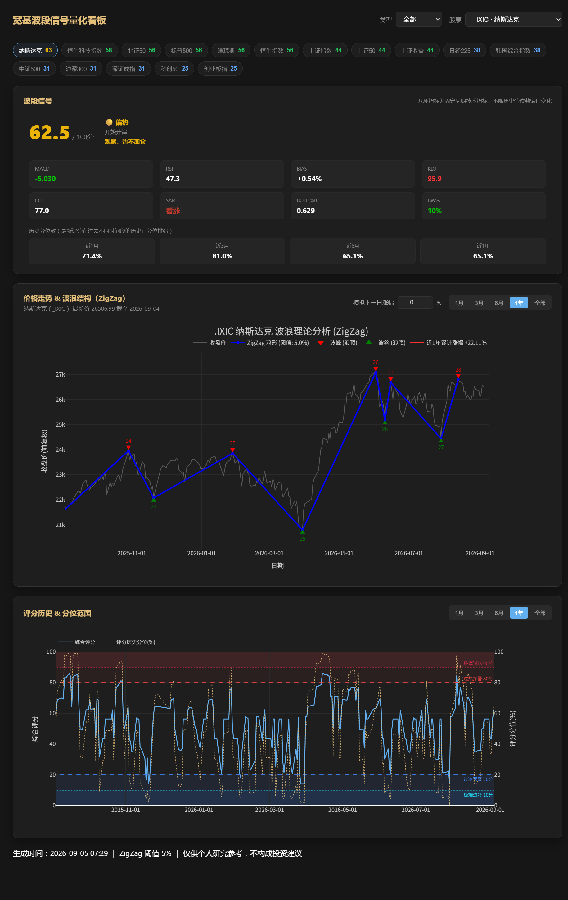 | https://owen434.github.io/broad-index-dashboard/stock_zigzag_signal_analyzer.html |
| | 评分矩阵 | 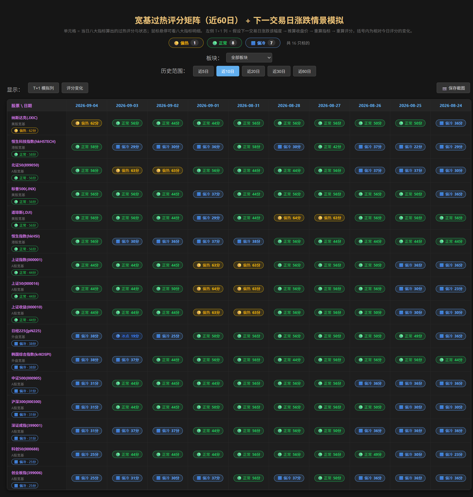 | https://owen434.github.io/broad-index-dashboard/stock_scorematrix.html |
| | 45只宽基ETF资金流看板 | 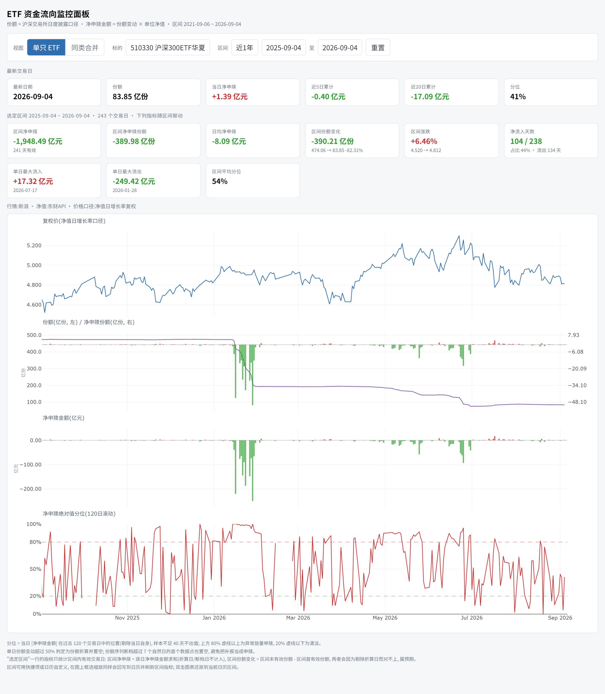 | https://owen434.github.io/broad-index-dashboard/etf_flow_dashboard.html |
| | ETF净申赎金额日历 | 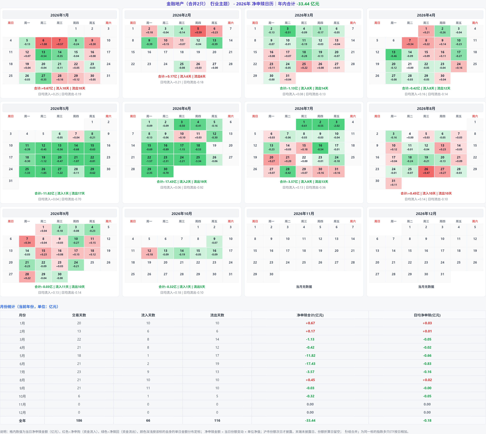 | https://owen434.github.io/broad-index-dashboard/etf_net_flow_calendar.html |
| | 宽基收益日历 | 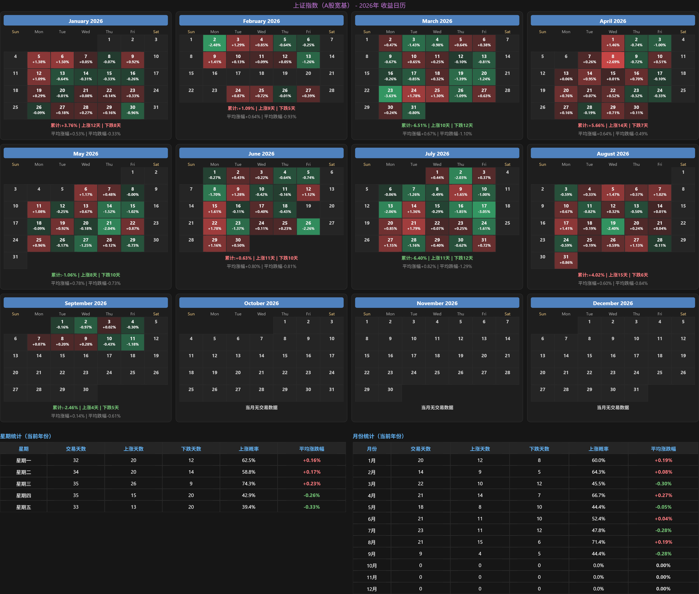 | https://owen434.github.io/broad-index-dashboard/index_return_calendar.html |
| **② 板块基金** | 八大指标矩阵 |  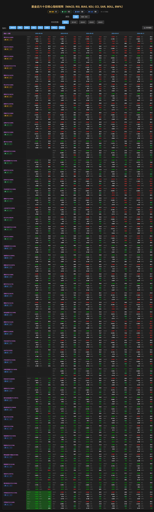  | https://owen434.github.io/broad-index-dashboard/fund_indicators_matrix.html |
| | 评分矩阵 | 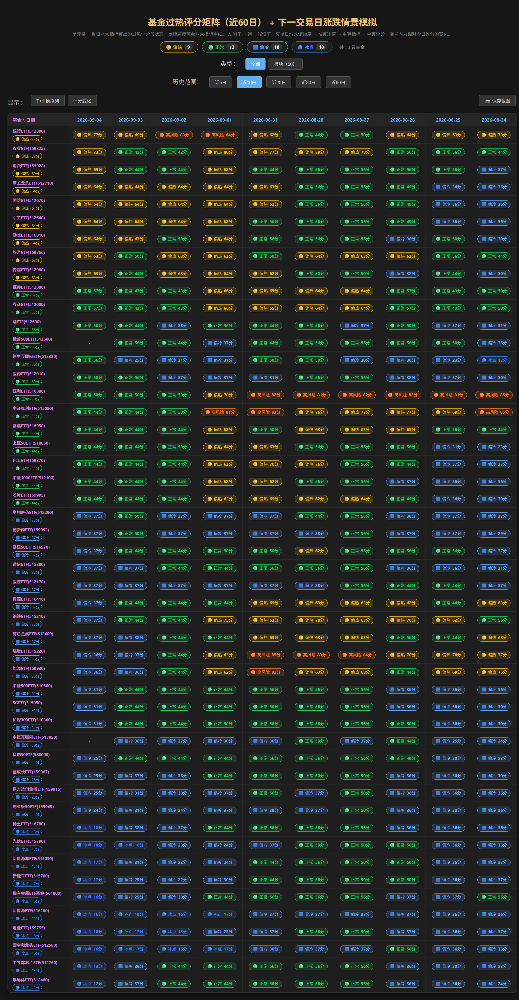| https://owen434.github.io/broad-index-dashboard/fund_score_matrix.html |
| | 风险排名百分位 | 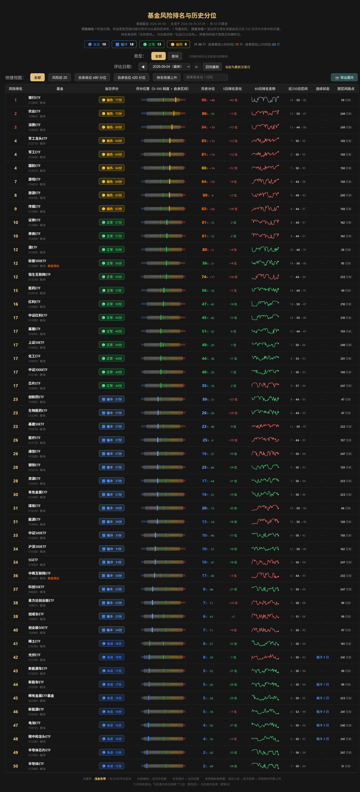 | https://owen434.github.io/broad-index-dashboard/fund_riskrank_percentile.html |
| | 板块基金收益日历 | 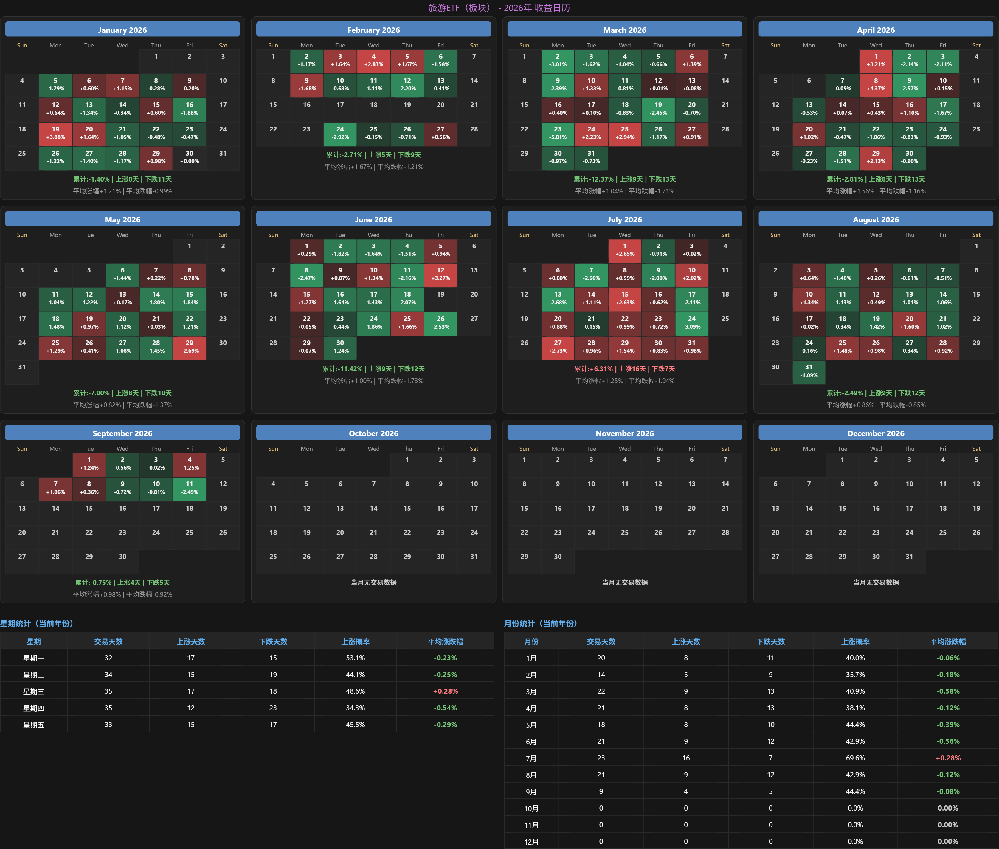 | https://owen434.github.io/broad-index-dashboard/holdings_calendar.html |
| | 基金相关性与聚类 | 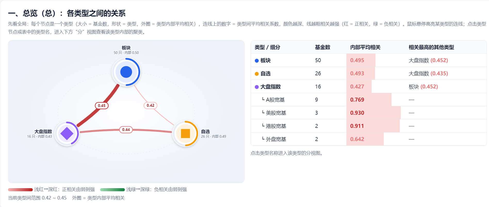| https://owen434.github.io/broad-index-dashboard/fund_correlation_report.html |
| | 基金异常分析 | 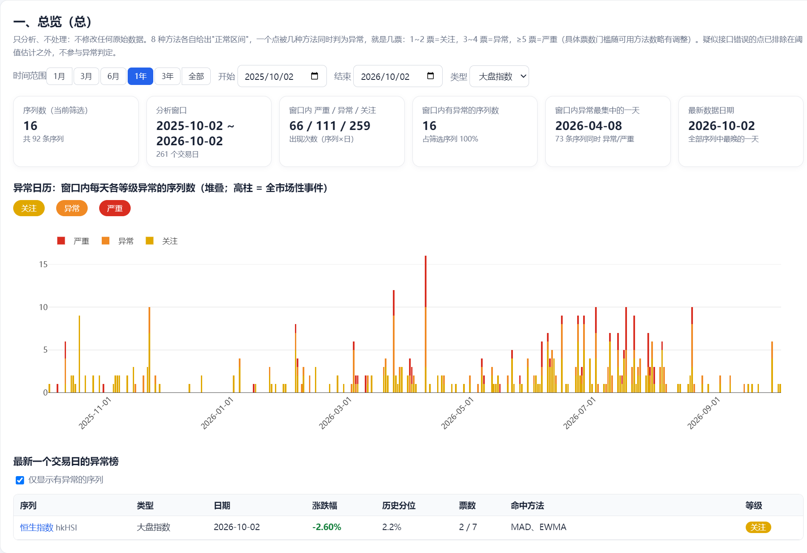 | https://owen434.github.io/broad-index-dashboard/fund_anomaly_analysis.html |
| **③ 回撤与信号回测** |宽基指数 + 基金回撤/过热信号回测|  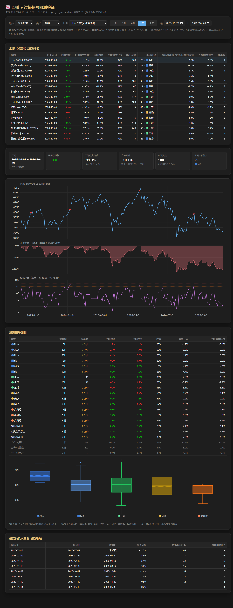 | https://owen434.github.io/broad-index-dashboard/drawdown_dashboard.html |
| **④ 股指期货持仓** |中信期货 / 前20会员净持仓|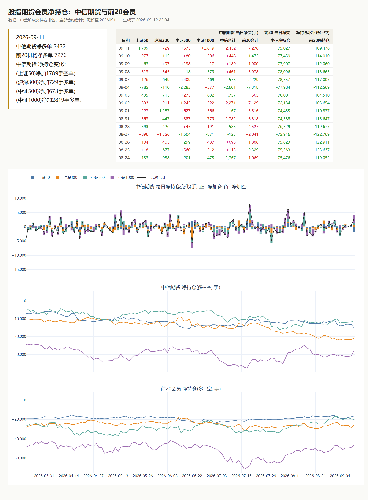 | https://owen434.github.io/broad-index-dashboard/cffex_net_position.html |
| **⑤ 黄金** | 多周期均线与斜率 | 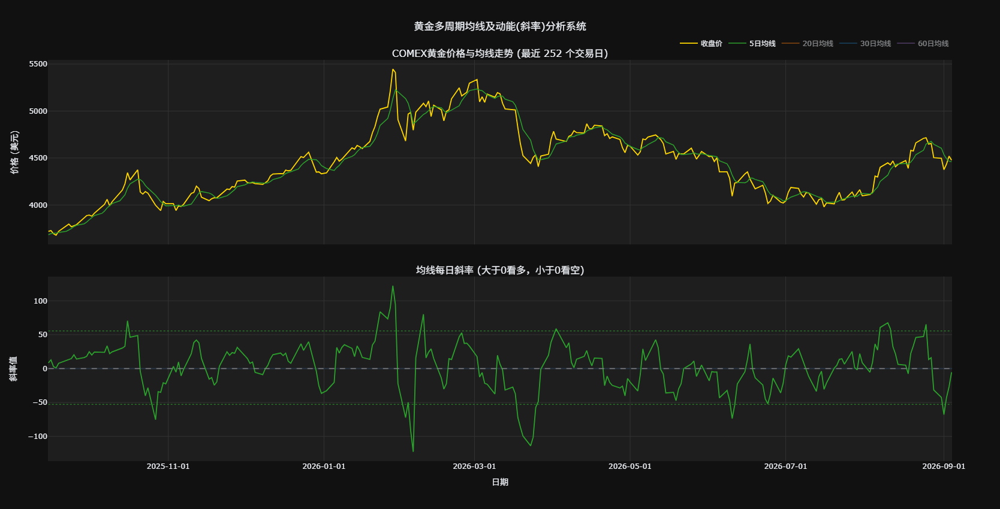 | https://owen434.github.io/broad-index-dashboard/gold_ma_slopes_interactive.html |

（链接对应 `docs/` 目录下 GitHub Actions 每个交易日自动重新生成的 HTML，首次运行前打开会 404。收益日历、股指期货持仓页面手机打开也能正常看：布局会自动收窄到单列，表格支持横向滑动。）

## 关于示例数据

`funds/funds_universe_example.csv` 只包含公开的板块 ETF（旅游ETF、酒ETF、消费ETF……），
不含任何人的真实持仓。想跑自己关注/持有的基金：复制这份 CSV，把 `基金代码`/`基金名称`
换成你自己的标的，`类型`列填 `板块` 或 `持有` 都可以——网页上的分类按钮会跟着 CSV
里实际出现的类型自动生成，不用改代码。

`stocks/stock_analysis_suite.py` 默认 `BROAD_INDEX_ONLY = True`：只分析约十来个
宽基指数（上证指数、沪深300…），不含个股。

## 本地运行

```bash
pip install -r requirements.txt
cd gold && python gold_ma_slope_analyzer.py
cd ../etf && python etf_broadbase_dashboard.py
python etf_net_flow_calendar.py       # 复用上一步生成的 etf_flow.parquet
# 首次没有 parquet，或希望重新抓取 ETF 数据时：
python etf_net_flow_calendar.py --refresh
cd ../funds && python fetch_fund_nav.py && python fund_indicators_matrix.py && python fund_score_matrix.py && python fund_riskrank_percentile.py && python holdings_calendar.py
python fund_correlation_report.py && python fund_anomaly_analysis.py   # 读 fetch_fund_nav.py 生成的 fund_nav_history.csv，需要先跑过它
cd ../stocks && python stock_analysis_suite.py && python index_return_calendar.py
cd ../drawdown && python drawdown_backtest.py --funds-csv ../funds/funds_universe_example.csv --nav-csv ../funds/fund_nav_history.csv --out drawdown_dashboard.html --plotly-js cdn
cd ../futures && python cffex_net_position.py --start 20240101   # 首次回填历史，之后不加参数增量更新即可
```

跑完直接双击打开对应目录下生成的 `.html` 文件即可。

## 已知限制

- `fund_correlation_report.py` / `fund_anomaly_analysis.py` 默认读 `fund_nav_history.csv`（收益率列 `日增长率`，
  也兼容 `增长率`）和 `funds_universe_example.csv`；分组完全由 CSV 的 `类型` 列决定，
  类型不足两个时"跨类型"部分为空。两者还会抓 16 个宽基指数做对照，抓不到的指数会列在页面的"未纳入"里，
  不影响基金本身；指数日线缓存在 `funds/index_cache/`（Actions 里用 actions/cache 持久化）。
- `drawdown/drawdown_backtest.py` 默认读取项目的 16 个宽基指数和基金清单；基金类型完全由 CSV 的 `类型` 列决定。
  它优先使用 `fund_nav_history.csv`，缺少净值历史时才逐只调用 AKShare；如果某只基金数据不足，会跳过该标的而继续生成看板。
- 回撤看板采用后复权净值计算基金收益和回撤，页面会显示检测到的拆分、份额折算和分红除权事件；若缺少复权内核或必要字段，会退回原始单位净值并在运行日志中提示。
- 异常分析只做判定、不修改任何数据；接口返回收盘价为 0 的指数（例如韩国综合指数最近一天）会被记作 -100%，
  并标为"疑似数据错误"，不计入正常异常统计。
- 数据源基于 AKShare 抓取国内财经网站接口，部分环境（尤其是境外网络）偶发限流或超时。
- 指标矩阵类的宽表格（`fund_indicators_matrix.html`、`stock_8indicators_matrix.html` 等）
  仍是桌面端宽屏设计，手机上需要横向滑动查看；收益日历和股指期货持仓这两个页面
  已经做了响应式适配，手机上会自动收窄成单列。
- `funds/fetch_fund_nav.py` 走的是场外/联接基金的净值接口，`funds_universe_example.csv`
  里如果混了场内 ETF 代码，个别可能抓不到净值（脚本会打印失败列表并跳过，不影响其余基金）。
- 收益日历页面的「截图导出」按钮依赖 CDN 上的 html2canvas，断网时点击会提示失败，
  不影响日历本身的浏览和切换。
- 收益日历目前只展示近两个自然年（今年+去年），如果需要更长历史，
  改 `YEARS_BACK` 常量即可，代价是 HTML 文件会等比例变大。
- `etf/etf_net_flow_calendar.py` 默认读取 `etf_flow.parquet`，该文件由
  `etf_broadbase_dashboard.py` 生成；如果文件不存在，脚本会自动回退到重新运行 ETF
  采集。Actions 中已将两个步骤串联，日历不会额外重复抓取。
- `futures/cffex_net_position.py` 抓的是中金所官网直连数据（非 AKShare 接口），
  首次运行会从 2024-01-01 全量回填、请求量较大（4个合约 × 全部交易日，几百次请求），
  用 `FETCH_WORKERS` 个线程小并发抓，通常几分钟内跑完；接入 `daily_update.yml` 后
  还靠 actions/cache 把中间结果缓存下来，之后每天只增量抓当天，耗时更短；
  如果日志里出现大量抓取失败，把 `FETCH_WORKERS` 调小或 `FETCH_STAGGER` 调大即可；
  图表默认走 CDN 加载 plotly.js（而不是内嵌进 HTML），断网环境打开页面看不到图，
  数据表格和文字快报不受影响，想离线可用就把脚本里的 `EMBED_PLOTLY_JS` 改成 `True`。

## 许可证与致谢

### License
本项目采用 [MIT License](LICENSE) 开源协议。

### 致谢与声明
- **数据支持**：本项目底层数据抓取依赖于优秀的开源项目 [AKShare](https://github.com/akfamily/akshare)，在此对开源社区及维护者们表示诚挚的感谢！
- **免责声明**：本项目所有输出的看板、评分、策略仅供个人量化学习与技术交流之用，不构成任何投资建议。**投资者据此操作，风险自负**。
