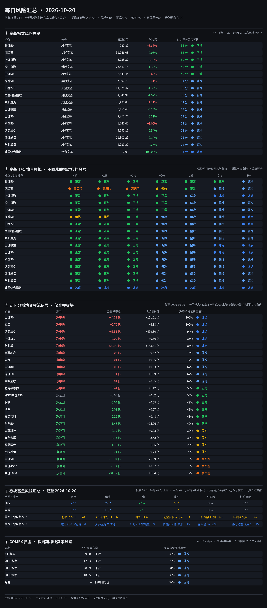

# 每日风险汇总 · 2026-10-19

> 风险口径：`🔵 冰点<20 · 🟦 偏冷<40 · 🟢 正常<60 · 🟡 偏热<80 · 🟠 高风险<90 · 🔴 极端风险≥90`，分位数(0~1)乘 100 后套同一张表。

## ① 宽基指数风险总览

| 指数 | 分类 | 最新点位 | 涨跌幅 | 过热评分 | 风险等级 |
|---|---|---:|---:|---:|---|
| 道琼斯 | 美股宽基 | 52,002.41 | -0.34% | 63 | 🟡 偏热 |
| 恒生指数 | 港股宽基 | 24,186.83 | +0.52% | 44 | 🟢 正常 |
| 恒生科技指数 | 港股宽基 | 4,108.24 | +1.16% | 42 | 🟢 正常 |
| 日经225 | 外盘宽基 | 64,916.70 | -0.62% | 36 | 🟦 偏冷 |
| 上证指数 | A股宽基 | 3,730.92 | +0.39% | 35 | 🟦 偏冷 |
| 标普500 | 美股宽基 | 7,659.44 | -1.09% | 31 | 🟦 偏冷 |
| 上证50 | A股宽基 | 2,774.30 | +0.22% | 30 | 🟦 偏冷 |
| 上证收益 | A股宽基 | 9,174.39 | +0.19% | 30 | 🟦 偏冷 |
| 沪深300 | A股宽基 | 4,174.53 | +0.09% | 29 | 🟦 偏冷 |
| 中证500 | A股宽基 | 6,800.66 | +0.41% | 28 | 🟦 偏冷 |
| 深证成指 | A股宽基 | 11,817.42 | +0.13% | 22 | 🟦 偏冷 |
| 科创50 | A股宽基 | 1,329.19 | -2.17% | 22 | 🟦 偏冷 |
| 创业板指 | A股宽基 | 2,746.29 | -0.94% | 22 | 🟦 偏冷 |
| 纳斯达克 | 美股宽基 | 26,140.03 | -2.14% | 21 | 🟦 偏冷 |
| 北证50 | A股宽基 | 946.15 | -0.40% | 14 | 🔵 冰点 |
| 韩国综合指数 | 外盘宽基 | 0.00 | -100.00% | 3 | 🔵 冰点 |

## ② 宽基 T+1 情景模拟（不同涨跌幅对应的风险）

| 指数 \ 明日涨跌 | +3% | +2% | +1% | +0% | -1% | -2% | -3% |
|---|---|---|---|---|---|---|---|
| 道琼斯 | 🟠 高风险 86 | 🟠 高风险 85 | 🟡 偏热 78 | 🟡 偏热 62 | 🟢 正常 44 | 🟢 正常 44 | 🟦 偏冷 29 |
| 恒生指数 | 🟡 偏热 71 | 🟡 偏热 63 | 🟡 偏热 63 | 🟢 正常 44 | 🟢 正常 42 | 🟦 偏冷 30 | 🟦 偏冷 27 |
| 恒生科技指数 | 🟢 正常 56 | 🟢 正常 56 | 🟢 正常 56 | 🟢 正常 43 | 🟦 偏冷 36 | 🟦 偏冷 30 | 🟦 偏冷 23 |
| 日经225 | 🟢 正常 56 | 🟢 正常 50 | 🟦 偏冷 37 | 🟦 偏冷 37 | 🟦 偏冷 36 | 🟦 偏冷 30 | 🟦 偏冷 24 |
| 上证指数 | 🟢 正常 58 | 🟢 正常 58 | 🟢 正常 50 | 🟢 正常 50 | 🟦 偏冷 23 | 🔵 冰点 15 | 🔵 冰点 14 |
| 标普500 | 🟡 偏热 71 | 🟢 正常 56 | 🟢 正常 56 | 🟦 偏冷 30 | 🟦 偏冷 21 | 🔵 冰点 19 | 🔵 冰点 18 |
| 上证50 | 🟢 正常 58 | 🟢 正常 58 | 🟢 正常 50 | 🟢 正常 50 | 🟦 偏冷 23 | 🔵 冰点 15 | 🔵 冰点 14 |
| 上证收益 | 🟢 正常 58 | 🟢 正常 58 | 🟢 正常 50 | 🟦 偏冷 35 | 🟦 偏冷 23 | 🔵 冰点 15 | 🔵 冰点 14 |
| 沪深300 | 🟢 正常 50 | 🟢 正常 50 | 🟢 正常 50 | 🟦 偏冷 29 | 🟦 偏冷 23 | 🟦 偏冷 21 | 🔵 冰点 14 |
| 中证500 | 🟢 正常 50 | 🟢 正常 50 | 🟢 正常 49 | 🟦 偏冷 29 | 🟦 偏冷 28 | 🟦 偏冷 22 | 🔵 冰点 16 |
| 深证成指 | 🟢 正常 50 | 🟢 正常 50 | 🟢 正常 42 | 🟦 偏冷 28 | 🟦 偏冷 28 | 🟦 偏冷 22 | 🟦 偏冷 21 |
| 科创50 | 🟢 正常 50 | 🟦 偏冷 35 | 🟦 偏冷 29 | 🟦 偏冷 28 | 🟦 偏冷 28 | 🔵 冰点 16 | 🔵 冰点 9 |
| 创业板指 | 🟢 正常 50 | 🟢 正常 49 | 🟦 偏冷 29 | 🟦 偏冷 28 | 🟦 偏冷 22 | 🟦 偏冷 22 | 🔵 冰点 15 |
| 纳斯达克 | 🟢 正常 56 | 🟦 偏冷 38 | 🟦 偏冷 25 | 🟦 偏冷 21 | 🟦 偏冷 21 | 🟦 偏冷 20 | 🔵 冰点 6 |
| 北证50 | 🟢 正常 58 | 🟦 偏冷 36 | 🟦 偏冷 23 | 🔵 冰点 16 | 🔵 冰点 15 | 🔵 冰点 8 | 🔵 冰点 7 |
| 韩国综合指数 | 🔵 冰点 3 | 🔵 冰点 3 | 🔵 冰点 3 | 🔵 冰点 3 | 🔵 冰点 3 | 🔵 冰点 3 | 🔵 冰点 3 |

## ③ ETF 分板块资金流信号（仅合并板块，截至 2026-10-19）

> 分位为**带方向**的滚动分位：越接近 100% = 放量净申购（资金进场，偏机会），越接近 0% = 放量净赎回（资金撤退，偏风险）。

| 板块 | 方向 | 当日净申赎(亿元) | 近5日(亿元) | 净申赎分位 | 资金信号 |
|---|---|---:|---:|---:|---|
| 上证50 | 净申购 | +20.32 | +72.11 | 98% | 🔵 冰点 |
| 中证500 | 净申购 | +46.99 | +48.30 | 98% | 🔵 冰点 |
| 军工 | 净申购 | +1.57 | +4.06 | 96% | 🔵 冰点 |
| 中证1000 | 净申购 | +37.25 | +41.05 | 91% | 🔵 冰点 |
| 深证100 | 净申购 | +0.75 | +2.19 | 91% | 🔵 冰点 |
| 沪深300 | 净申购 | +34.02 | +411.40 | 89% | 🔵 冰点 |
| 科创50 | 净申购 | +7.56 | +19.65 | 88% | 🔵 冰点 |
| 中证A500 | 净申购 | +0.14 | +0.36 | 87% | 🔵 冰点 |
| 中证800 | 净申购 | +0.21 | +0.63 | 86% | 🔵 冰点 |
| 创业板 | 净申购 | +20.92 | +153.08 | 86% | 🔵 冰点 |
| 汽车 | 净申购 | +0.05 | +0.07 | 83% | 🔵 冰点 |
| 上证180 | 净申购 | +0.06 | +0.28 | 78% | 🟦 偏冷 |
| MSCI中国A50 | 净申购 | +0.05 | +0.32 | 73% | 🟦 偏冷 |
| 光伏 | 净申购 | +0.01 | -0.33 | 73% | 🟦 偏冷 |
| 金融科技 | 净申购 | +0.10 | +1.06 | 60% | 🟦 偏冷 |
| 钢铁 | 净申购 | +0.02 | +0.13 | 59% | 🟢 正常 |
| 芯片半导体 | 净赎回 | -0.58 | +0.14 | 45% | 🟢 正常 |
| 食品饮料 | 净赎回 | -0.19 | +0.80 | 44% | 🟢 正常 |
| 金融地产 | 净赎回 | -0.11 | -0.54 | 41% | 🟢 正常 |
| 有色金属 | 净赎回 | -0.80 | -3.98 | 38% | 🟡 偏热 |
| 中概互联 | 净赎回 | +0.00 | -0.06 | 31% | 🟡 偏热 |
| 畜牧养殖 | 净赎回 | -0.14 | +0.14 | 27% | 🟡 偏热 |
| 医药医疗 | 净赎回 | -1.78 | +1.18 | 22% | 🟡 偏热 |

## ④ 板块基金风险汇总（截至 2026-10-19）

| 类型 / 排行 | 🔵 冰点 | 🟦 偏冷 | 🟢 正常 | 🟡 偏热 | 🟠 高风险 | 🔴 极端风险 |
|---|:---:|:---:|:---:|:---:|:---:|:---:|
| **板块** | 6 只 | 30 只 | 18 只 | 7 只 | 1 只 | 0 只 |
| **自选** | 15 只 | 6 只 | 4 只 | 1 只 | 0 只 | 0 只 |
| **最热 Top6（名次 →）** | 1. 银行ETF 83 | 2. 酒ETF 76 | 3. 标普消费ETF景顺 76 | 4. 标普油气ETF富国 65 | 5. 道琼斯ETF鹏华 63 | 6. 创金合信先进装备股票C 63 |
| **最冷 Top6（名次 →）** | 1. 天弘全球高端制造混合(QDII)C 5 | 2. 建信新兴市场混合(QDII)C 6 | 3. 国富亚洲机会股票(QDII)C 7 | 4. 易方达全球成长精选混合(QDII)人民币C 7 | 5. 嘉实全球产业升级股票发起式(QDII)C 8 | 6. 东方人工智能主题混合C 9 |

> **板块** 共 62 只，平均 39 分 🟦 偏冷；**自选** 共 26 只，平均 23 分 🟦 偏冷。第一行是六档的只数分布；后两行按名次从左到右排，格子落在哪一列只表示名次，与该列的档位无关。

## ⑤ COMEX 黄金 · 多周期均线斜率风险

最新价：4,162.0 美元 · 2026-10-19

| 周期 | 均线斜率 | 方向 | 斜率分位 | 风险等级 |
|---|---:|---|---:|---|
| 5 日 | -6.740 | 下行 | 38% | 🟦 偏冷 |
| 20 日 | -10.940 | 下行 | 23% | 🟦 偏冷 |
| 30 日 | -9.663 | 下行 | 28% | 🟦 偏冷 |
| 60 日 | +0.400 | 上行 | 37% | 🟦 偏冷 |
| 综合 | -- | 四周期均值 | 32% | 🟦 偏冷 |

---
生成时间 2026-10-19 23:58　数据源 AKShare。
本页为技术观察，不构成任何投资建议。