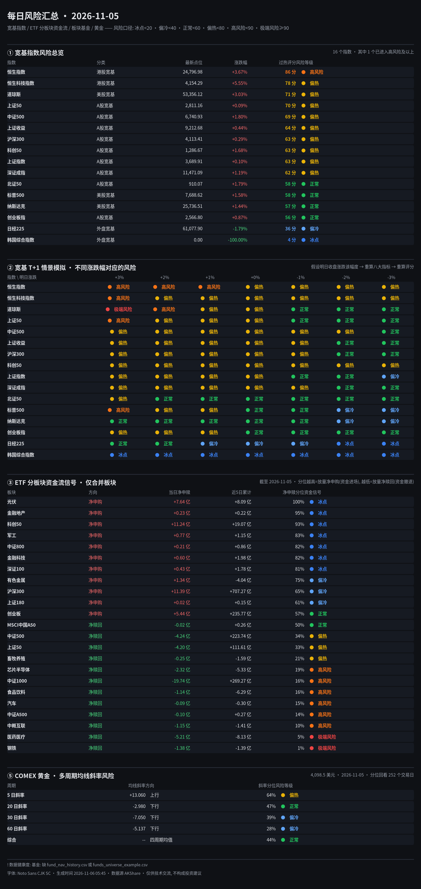

# 每日风险汇总 · 2026-11-03

> 风险口径：`🔵 冰点<20 · 🟦 偏冷<40 · 🟢 正常<60 · 🟡 偏热<80 · 🟠 高风险<90 · 🔴 极端风险≥90`，分位数(0~1)乘 100 后套同一张表。

## ① 宽基指数风险总览

| 指数 | 分类 | 最新点位 | 涨跌幅 | 过热评分 | 风险等级 |
|---|---|---:|---:|---:|---|
| 恒生指数 | 港股宽基 | 23,525.97 | +0.57% | 64 | 🟡 偏热 |
| 上证50 | A股宽基 | 2,768.27 | +0.21% | 63 | 🟡 偏热 |
| 恒生科技指数 | 港股宽基 | 3,867.73 | +0.74% | 58 | 🟢 正常 |
| 上证收益 | A股宽基 | 8,997.72 | +0.21% | 56 | 🟢 正常 |
| 中证500 | A股宽基 | 6,327.05 | -1.45% | 44 | 🟢 正常 |
| 上证指数 | A股宽基 | 3,608.10 | -0.82% | 43 | 🟢 正常 |
| 日经225 | 外盘宽基 | 63,081.86 | -0.33% | 42 | 🟢 正常 |
| 沪深300 | A股宽基 | 4,008.88 | -0.20% | 38 | 🟦 偏冷 |
| 道琼斯 | 美股宽基 | 51,983.98 | +0.41% | 37 | 🟦 偏冷 |
| 深证成指 | A股宽基 | 10,876.99 | -1.21% | 32 | 🟦 偏冷 |
| 创业板指 | A股宽基 | 2,391.65 | -2.73% | 25 | 🟦 偏冷 |
| 标普500 | 美股宽基 | 7,541.40 | -0.51% | 20 | 🟦 偏冷 |
| 科创50 | A股宽基 | 1,151.28 | -3.81% | 18 | 🔵 冰点 |
| 纳斯达克 | 美股宽基 | 25,164.32 | -1.07% | 15 | 🔵 冰点 |
| 韩国综合指数 | 外盘宽基 | 0.00 | -100.00% | 10 | 🔵 冰点 |
| 北证50 | A股宽基 | 855.06 | -4.02% | 9 | 🔵 冰点 |

## ② 宽基 T+1 情景模拟（不同涨跌幅对应的风险）

| 指数 \ 明日涨跌 | +3% | +2% | +1% | +0% | -1% | -2% | -3% |
|---|---|---|---|---|---|---|---|
| 恒生指数 | 🟡 偏热 71 | 🟡 偏热 65 | 🟡 偏热 65 | 🟡 偏热 65 | 🟢 正常 43 | 🟢 正常 43 | 🟦 偏冷 36 |
| 上证50 | 🟡 偏热 79 | 🟡 偏热 77 | 🟡 偏热 64 | 🟡 偏热 63 | 🟢 正常 44 | 🟦 偏冷 36 | 🟦 偏冷 29 |
| 恒生科技指数 | 🟡 偏热 65 | 🟡 偏热 65 | 🟡 偏热 65 | 🟡 偏热 65 | 🟢 正常 57 | 🟢 正常 42 | 🟦 偏冷 37 |
| 上证收益 | 🟡 偏热 62 | 🟡 偏热 62 | 🟢 正常 56 | 🟢 正常 56 | 🟢 正常 44 | 🟦 偏冷 37 | 🟦 偏冷 23 |
| 中证500 | 🟢 正常 56 | 🟢 正常 56 | 🟢 正常 56 | 🟢 正常 44 | 🟦 偏冷 37 | 🟦 偏冷 31 | 🟦 偏冷 30 |
| 上证指数 | 🟢 正常 56 | 🟢 正常 56 | 🟢 正常 56 | 🟢 正常 44 | 🟦 偏冷 30 | 🟦 偏冷 22 | 🔵 冰点 16 |
| 日经225 | 🟡 偏热 63 | 🟢 正常 57 | 🟢 正常 43 | 🟢 正常 43 | 🟦 偏冷 37 | 🟦 偏冷 36 | 🟦 偏冷 36 |
| 沪深300 | 🟢 正常 56 | 🟢 正常 56 | 🟢 正常 56 | 🟢 正常 44 | 🟦 偏冷 32 | 🟦 偏冷 25 | 🟦 偏冷 24 |
| 道琼斯 | 🟡 偏热 71 | 🟡 偏热 63 | 🟢 正常 56 | 🟦 偏冷 37 | 🟦 偏冷 36 | 🟦 偏冷 22 | 🔵 冰点 20 |
| 深证成指 | 🟢 正常 56 | 🟢 正常 56 | 🟢 正常 56 | 🟦 偏冷 38 | 🟦 偏冷 31 | 🟦 偏冷 25 | 🟦 偏冷 24 |
| 创业板指 | 🟢 正常 56 | 🟢 正常 43 | 🟦 偏冷 31 | 🟦 偏冷 31 | 🟦 偏冷 31 | 🔵 冰点 19 | 🔵 冰点 18 |
| 标普500 | 🟢 正常 57 | 🟢 正常 56 | 🟢 正常 42 | 🟦 偏冷 21 | 🔵 冰点 19 | 🔵 冰点 13 | 🔵 冰点 12 |
| 科创50 | 🟢 正常 56 | 🟦 偏冷 38 | 🟦 偏冷 32 | 🟦 偏冷 25 | 🔵 冰点 19 | 🔵 冰点 18 | 🔵 冰点 17 |
| 纳斯达克 | 🟢 正常 58 | 🟢 正常 42 | 🟦 偏冷 36 | 🟦 偏冷 22 | 🔵 冰点 15 | 🔵 冰点 8 | 🔵 冰点 7 |
| 韩国综合指数 | 🔵 冰点 4 | 🔵 冰点 4 | 🔵 冰点 4 | 🔵 冰点 4 | 🔵 冰点 4 | 🔵 冰点 4 | 🔵 冰点 4 |
| 北证50 | 🟦 偏冷 36 | 🟦 偏冷 30 | 🟦 偏冷 29 | 🔵 冰点 16 | 🔵 冰点 10 | 🔵 冰点 8 | 🔵 冰点 8 |

## ③ ETF 分板块资金流信号（仅合并板块，截至 2026-11-03）

> 分位为**带方向**的滚动分位：越接近 100% = 放量净申购（资金进场，偏机会），越接近 0% = 放量净赎回（资金撤退，偏风险）。

| 板块 | 方向 | 当日净申赎(亿元) | 近5日(亿元) | 净申赎分位 | 资金信号 |
|---|---|---:|---:|---:|---|
| 沪深300 | 净申购 | +336.52 | +683.82 | 100% | 🔵 冰点 |
| 上证50 | 净申购 | +103.78 | +105.95 | 100% | 🔵 冰点 |
| 创业板 | 净申购 | +95.99 | +214.36 | 100% | 🔵 冰点 |
| 金融地产 | 净申购 | +0.46 | +0.11 | 99% | 🔵 冰点 |
| 中证500 | 净申购 | +57.40 | +117.02 | 97% | 🔵 冰点 |
| 中证1000 | 净申购 | +67.47 | +161.52 | 97% | 🔵 冰点 |
| 深证100 | 净申购 | +0.53 | +0.94 | 88% | 🔵 冰点 |
| 金融科技 | 净申购 | +0.68 | +1.43 | 86% | 🔵 冰点 |
| 光伏 | 净申购 | +0.03 | -0.14 | 76% | 🟦 偏冷 |
| MSCI中国A50 | 净申购 | +0.07 | +0.26 | 75% | 🟦 偏冷 |
| 科创50 | 净申购 | +4.44 | +14.70 | 74% | 🟦 偏冷 |
| 医药医疗 | 净申购 | +0.42 | -1.27 | 71% | 🟦 偏冷 |
| 上证180 | 净申购 | +0.04 | +0.11 | 68% | 🟦 偏冷 |
| 军工 | 净申购 | +0.34 | +1.32 | 66% | 🟦 偏冷 |
| 中概互联 | 净申购 | +0.02 | +0.02 | 64% | 🟦 偏冷 |
| 中证800 | 净申购 | +0.05 | +0.75 | 62% | 🟦 偏冷 |
| 芯片半导体 | 净申购 | +0.61 | +0.17 | 62% | 🟦 偏冷 |
| 钢铁 | 净赎回 | -0.04 | -0.16 | 48% | 🟢 正常 |
| 中证A500 | 净赎回 | -0.03 | +0.30 | 40% | 🟢 正常 |
| 有色金属 | 净赎回 | -0.89 | -6.20 | 38% | 🟡 偏热 |
| 食品饮料 | 净赎回 | -0.67 | -0.97 | 27% | 🟡 偏热 |
| 汽车 | 净赎回 | -0.13 | -0.09 | 13% | 🟠 高风险 |
| 畜牧养殖 | 净赎回 | -0.54 | -0.62 | 8% | 🔴 极端风险 |

## ④ 板块基金风险汇总（截至 2026-11-03）

| 类型 / 排行 | 🔵 冰点 | 🟦 偏冷 | 🟢 正常 | 🟡 偏热 | 🟠 高风险 | 🔴 极端风险 |
|---|:---:|:---:|:---:|:---:|:---:|:---:|
| **板块** | 10 只 | 14 只 | 24 只 | 10 只 | 3 只 | 1 只 |
| **自选** | 14 只 | 8 只 | 3 只 | 1 只 | 0 只 | 0 只 |
| **最热 Top6（名次 →）** | 1. 消费ETF 94 | 2. 酒ETF 88 | 3. 旅游ETF 85 | 4. 保险ETF 83 | 5. 信澳产业优选一年持有混合C 78 | 6. 广发美国房地产指数人民币(QDII)A 78 |
| **最冷 Top6（名次 →）** | 1. 纳指科技ETF景顺 8 | 2. 易方达标普信息科技指数(QDII-LOF)A(人民币) 9 | 3. 前海开源金银珠宝混合C 10 | 4. 国联安优选行业混合A 13 | 5. 信澳业绩驱动混合C 13 | 6. 财通集成电路产业股票C 13 |

> **板块** 共 62 只，平均 45 分 🟢 正常；**自选** 共 26 只，平均 26 分 🟦 偏冷。第一行是六档的只数分布；后两行按名次从左到右排，格子落在哪一列只表示名次，与该列的档位无关。

## ⑤ COMEX 黄金 · 多周期均线斜率风险

最新价：3,930.7 美元 · 2026-11-03

| 周期 | 均线斜率 | 方向 | 斜率分位 | 风险等级 |
|---|---:|---|---:|---|
| 5 日 | -28.480 | 下行 | 18% | 🔵 冰点 |
| 20 日 | -13.100 | 下行 | 21% | 🟦 偏冷 |
| 30 日 | -15.503 | 下行 | 10% | 🔵 冰点 |
| 60 日 | -8.283 | 下行 | 20% | 🔵 冰点 |
| 综合 | -- | 四周期均值 | 17% | 🔵 冰点 |

---
生成时间 2026-11-04 05:09　数据源 AKShare。
本页为技术观察，不构成任何投资建议。